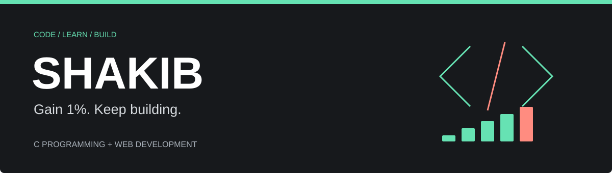

  

  <b>Learning programming. Building for the web. Getting better, one project at a time.</b>

  <a href="https://github.com/Shakib-2009/C-Program-Practice-">C Programming</a> &nbsp; / &nbsp;
  <a href="https://github.com/Shakib-2009/My-Practice-">Web Projects</a> &nbsp; / &nbsp;
  <a href="https://github.com/Shakib-2009?tab=repositories">All Repositories</a>

---

### Hey, I'm Shakib

I'm learning C programming and full-stack web development through practice, assignments, and projects. I like working through a problem, understanding why the code behaves the way it does, and improving it step by step.

My approach is simple: **Gain 1%. Keep building.**

### What I'm Working On

- **Programming fundamentals:** arrays, loops, sorting, strings, and searching in C.
- **Web development:** HTML, CSS, JavaScript, Bootstrap, and jQuery.
- **Git & GitHub:** keeping my practice organized and sharing my progress.

### My Toolkit

  
  
  
  
  
  
  

### Explore My Work

| Project | What you'll find |
| --- | --- |
| [C Programming Practice](https://github.com/Shakib-2009/C-Program-Practice-) | Assignments and exercises covering programming fundamentals. |
| [Student Name Search](https://github.com/Shakib-2009/C-Program-Practice-/blob/main/Assignment%202/Question%2027.cpp) | A two-dimensional character array, string comparisons, and a search loop. |
| [SK Learning Website](https://github.com/Shakib-2009/My-Practice-/tree/main/Mars-tech%20HTML%20CSS%20project) | A learning website with course, instructor, admission, and contact pages. |
| [JavaScript Practice](https://github.com/Shakib-2009/My-Practice-/tree/main/java-script) | Browser-based practice and a calculator page. |

---

<b>Understand it. Practice it. Build on it.</b>

